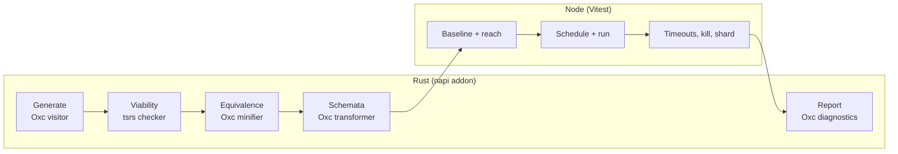

# Plan: vile, mutation testing for TypeScript built on Oxc, tsrs and Vitest

## Names

- **CLI:** `vile`.
- **Rust crates:** `vile_core`, `vile_generate`, `vile_types` and so on, following Oxc's `oxc_*`. The name is free on crates.io.
- **npm:** the `@vile` scope if it can be claimed (`@vile/cli`, `@vile/vitest`, `@vile/binding-linux-x64`, …), otherwise `@claas.dev/vile`, `@claas.dev/vile-vitest` and so on. The unscoped `vile` on npm belongs to an old, unrelated package.

## Goal

Tell a developer where their code could be wrong without any test noticing, with as little noise as possible, in a TypeScript or JavaScript project tested with Vitest. Easy to run: no setup, no change to the source tree.

vile is a general tool, so it follows the state of the art rather than one project's habits. It reports the counts of each outcome and the mutation score, as PIT, Stryker and cargo-mutants do, and its exit code says whether any mutant was missed. A threshold that fails the run is optional and off by default. The documentation says what the research says about the score: it measures the tests against the mutants vile generated, it isn't comparable between tools or projects, and it turns into a target like coverage if it's chased. Google shows developers individual mutants in review, not a score (Petrović et al.).

## Why build it

Stryker works, but in practice it needs workarounds (seen in a real project's `stryker.config.mjs`):

- **Config:** JavaScript only.
- **Plugins:** they have to be named, because Stryker doesn't find them in pnpm's `node_modules`.
- **Sandbox:** it copies the whole repository, and the copy breaks on symlinks.
- **TypeScript 7:** it rewrites `tsconfig.json` through TypeScript's JavaScript API, which TypeScript 7 removed.
- **Mutants:** it only sees syntax, so it can't skip mutants that don't type-check or choose replacement values by type.

## Architecture

- **Rust analyzes; Node runs.** Vitest's API is JavaScript, and warm workers are where the speed comes from. Spawning a Vitest process per mutant, as cargo-mutants spawns `cargo test`, would spend most of the run on startup.
- **Each mutant has two forms:**
  - **A text patch** (span plus replacement): what tsrs checks, the equivalence check compares, reports show as a diff, and `--in-place` applies. It edits text, not the tree, so formatting, comments and line numbers stay put (as in cargo-mutants).
  - **A schema branch**, `__m === 17 ? (a <= b) : (a < b)`, in one transformed module per file: what actually runs, so no file is transformed again per mutant. Types are stripped, so the schemata don't have to type-check.
- **Positions:** Oxc spans and tsrs positions are both UTF-8 byte offsets, so they line up without conversion.

### Outcomes

| Outcome | Meaning | Tests run? |
| --- | --- | --- |
| caught | A test failed | yes |
| missed | Every covering test passed | yes |
| timeout | Ran past the limit and was killed. Reported, often a loop guard | yes |
| unviable | tsrs found a type error | no |
| equivalent | The minified code is identical to the original's (Trivial Compiler Equivalence) | no |
| not reached | No test runs this code. Reported as untested code, not as survivors | no |
| skipped | A disable comment or an arid rule | no |

## Mutation operators

Start small (selective mutation, Offutt et al.). Every operator has to earn its place by finding productive mutants.

1. **Function body replacement** (cargo-mutants' `FnValue`, extreme mutation in PIT's Descartes): replace the body with a value of the return type, which tsrs supplies:
   - `void` / `Promise<void>`: empty body
   - `boolean`: `true`, `false`
   - `number`: `0`, `1`, `-1`
   - `string`: `""`, `"xyzzy"`
   - `T[]`: `[]`
   - `T | undefined`: `undefined`
   - a union of literals: each member

   Branded types reject most of these at the viability check, which is intended.
2. **Relational, the sufficient set** (Kaminski, Ammann, Offutt):

   | Original | Replacements |
   | --- | --- |
   | `<` | `<=`, `!=`, `false` |
   | `<=` | `<`, `==`, `true` |
   | `>` | `>=`, `!=`, `false` |
   | `>=` | `>`, `==`, `true` |
   | `===` | `<=`, `>=`, `false` |
   | `!==` | `<`, `>`, `true` |

   The `<`/`>` forms of the `===`/`!==` rows only type-check on ordered types, and tsrs drops the rest. NaN breaks some of the subsumption; that's accepted.
3. **Logical:** `&&` ↔ `||`, and `??` → its left side.
4. **Arithmetic:** `+` → `-`, `-` → `+`, `*` → `/`, `/` → `*`, `%` → `*`.
5. **Unary:** remove `!`, and remove unary `-`.
6. **Statement block removal** (Google's SBR): empty a block that isn't a function body.
7. **TypeScript and JavaScript specific, after measuring:** `?.` → `.` (tsrs rejects most), a ternary to either branch, `some` ↔ `every`, removing a `filter` call.

Left out at first: string literal changes, the mutation of numeric literals in constants, and turning a `Result`-like return into its other variant. They're collected in [Future work (#1)](https://github.com/SantaClaas/vile/issues/1), with posting survivors as pull request review comments. Google found ABS insertion mostly unproductive.

## Noise control

Google's productivity went from about 15% to 89% through filtering, not through more operators (Petrović et al., *Practical Mutation Testing at Scale*). In order:

1. **Unviable:** the tsrs check, before any test runs.
2. **Equivalent and duplicate:** Trivial Compiler Equivalence (Papadakis et al., ICSE 2015). Minify the enclosing function, original and mutant, with Oxc's minifier. If the output is identical, the mutant is equivalent; mutants with identical output are duplicates, and one of them runs.
3. **Arid code:** never mutated. Defaults: `console.*`, calls whose name starts with `log`, and capacity or size hints. The project config adds more, like cargo-mutants' `skip_calls`. Each rule is checked against real feedback.
4. **Disable comments,** shaped like oxlint's, with a required reason: `// vile-disable-next-line relational -- cache key, order doesn't matter`, plus `// vile-disable` before a function for all of it. A disable without a reason is an error.
5. **Review mode:** report at most one survivor per statement. This differs from Google, which *generates* one mutant per line at random to save compute, and limits a changelist to 7 × its file count. See "Unit of the limit" below.

### Unit of the limit

Google's paper says "we generate at most a single mutant in a line" and gives no reason for choosing the line. Its code is formatted by tools, so a line is a stable stand-in there. A companion study found that when one mutant on a line is killed, the others usually are too. A line is still a property of formatting, not of the code. The tool:

- **Full runs:** runs every viable, non-equivalent mutant, and reduces with the sufficient sets and the equivalence check rather than sampling.
- **Review mode and `--in-diff`:** groups survivors by their smallest enclosing statement and shows one per group, with the rest folded under it. A statement with two independent decisions (`a < b && c > d`) still shows only one.

## Workflow features (from cargo-mutants)

- **Baseline first.** Tests that already fail stop the run. The baseline time sets the timeout: 5× the baseline, at least 20 s by default.
- **Reach map.** During the baseline, a counter in each mutant's branch records which tests reach it (PIT's and Stryker's per-test coverage). Each mutant then runs only the tests that reach it, fastest first, and stops at the first failure.
- **`--list`** with diffs, and **`--in-diff <file>`** to mutate only changed lines. **`--iterate`** retests only what was missed. **`--shard k/n`** splits a run for CI.
- **Mutant identity** that survives edits elsewhere: the file, the enclosing function's name path, a hash of the original snippet, the operator and the replacement. Not line and column, which is the weak spot cargo-mutants names in `--iterate`.
- **`vile.out/`**, written as the run goes (cargo-mutants' `mutants.out/`):
  - `mutants.json` and `outcomes.json`
  - a diff and a log per mutant
  - a text list per outcome
  - a report in Stryker's mutation-testing-elements JSON schema, so its HTML viewer works
- **Terminal output:** survivors as Oxc diagnostics (code frame plus diff), so they look like oxlint's findings. Exit codes like cargo-mutants'. Ctrl-C kills the worker processes too.
- **No config needed.** By default it mutates the source files the tests import, never the test files themselves.
- **Two ways in, one config:** the `vile` CLI, and a Vitest plugin (`vile()` in the `plugins` of `vitest.config.ts`) that takes the options, typed. The CLI loads the Vitest config, so the options live in one place. Vitest has no way for a plugin to add a command, so the CLI is the entry point for running.

## Risks and how the plan meets them

| Risk | Answer |
| --- | --- |
| tsrs's Rust API is Go-shaped and not designed for embedding | Spike it first (S2). Fallback: `tsrs --api` over IPC, or the viability check as a separate tsrs process |
| Vitest internals change between majors | One small package touches Vitest. Pin versions and test against the latest |
| A synchronous infinite loop can't be cancelled inside a worker | `forks` pool. The host kills the process and starts a new one, as cargo-mutants kills the process group |
| Inferred return types: checking one file misses errors in another | Check the files that import the mutated one when the function has no written return type |
| tsrs needs Rust 1.100, newer than some machines have | `rust-toolchain.toml` pins the version, as tsrs does, so rustup installs it |
| Schemata change semantics (hoisting, evaluation order) | Switch at expression level. Every operator has a test that runs the schema and the patched text and compares results |

## License and credits

- **License:** `MIT OR Apache-2.0`, the Rust ecosystem's usual choice, compatible with everything below.
- **Credits** in the README and in `NOTICE`:

  | Project | License | What we use |
  | --- | --- | --- |
  | Oxc | MIT | parser, AST, minifier, transformer, diagnostics |
  | tsrs | Apache-2.0 | checker. Its `NOTICE` (TypeScript, DefinitelyTyped) has to ship with any binary that embeds it, since tsrs embeds TypeScript's `lib.*.d.ts` |
  | Vitest | MIT | runner |
  | napi-rs | MIT | Node binding |
  | cargo-mutants (Martin Pool) | MIT | design: outcomes, baseline, timeouts, `mutants.out`, `--in-diff`, `--iterate`, body replacement. If code is copied, its copyright line goes with it |
  | Stryker | Apache-2.0 (to check) | report schema, mutation switching |
  | Research | — | cited in the docs: DeMillo, Lipton and Sayward; Offutt; Kaminski, Ammann and Offutt; Papadakis et al.; Just et al.; Petrović, Ivanković, Fraser and Just |
- **License checks:** `cargo-deny` (licenses, sources, advisories) and generated third-party notices (`cargo-about`) in CI, so the notices can't drift from `Cargo.lock`.

## Phases and the split onto subagents

Bottom-up: one working vertical slice first, then parallel work on the pieces it proved.

### Phase 0: scaffold (main session, sequential)

Everything the parallel work depends on:

- **Repository:** Cargo workspace plus pnpm workspace, the license files, `NOTICE`, the README credits, and CI (fmt, clippy, cargo-deny, oxfmt, oxlint, tests).
- **Contracts crate** (`vile_core`): `Mutant`, `Patch`, `Outcome`, `MutantId`, operator names, and the JSON shape of `mutants.json` and `outcomes.json`. Changes to it go through the main session.
- **Fixture projects** (`fixtures/`): small TypeScript plus Vitest projects, each with expected outcomes per mutant. They are the acceptance tests every workstream runs against.
- **Guidelines** carried over from the week budget planner as they are: names, pure core, return early, one operation per `try`, declare before use, strict lint with reasoned exceptions, the supply-chain settings, actions pinned by hash, typos. Rust gets the equivalents (`Result`, `#[expect(..., reason = "...")]` instead of `#[allow]`, clippy at tsrs's strictness). Where a tool needs something an app doesn't, the guideline says so:
  - **Users' versions.** The app pins the latest Node; a tool runs on its users' Node, so vile supports the Node releases that are still maintained and the current Vitest major, and CI tests the oldest and the newest.
  - **A public interface.** The CLI flags, the config, the JSON in `vile.out/` and the exit codes are a contract with other programs. They follow semantic versioning, and a change to them is called out in the changelog.
  - **Output is part of the interface.** Terminal output is for people and may change; anything a program should read goes in the JSON.

### Phase 1: spikes (two subagents, in parallel)

| Agent | Delivers | Done when |
| --- | --- | --- |
| **S1 vertical slice** | Oxc finds `<` sites and function bodies, applies text patches, and drives Vitest's Node API in one process with module invalidation, no schemata yet | Runs on a fixture and on the week budget planner's `src/plan/`. Records time and kill counts next to Stryker's |
| **S2 tsrs embedding** | Load the project from `tsconfig.json` through the tsrs crates, get a function's return type, check a patched file through the overlay, measure the time per mutant | A written verdict: crates in process, or the IPC fallback, with numbers |

The main session reviews both and adjusts the contracts.

### Phase 2: workstreams (subagents, in parallel, one directory each)

| Agent | Owns | Needs | Done when |
| --- | --- | --- | --- |
| **A generate** | `crates/vile_generate`: operators above, skip rules (tests, disable comments, arid calls), mutant identity | contracts | Every operator has fixture tests. Identity holds across unrelated edits |
| **B types** | `crates/vile_types`: tsrs project, return-type shapes for body replacement, viability check | S2 verdict | Unviable mutants in fixtures are rejected with their diagnostic. Time per check documented |
| **C equivalence** | `crates/vile_equivalence`: Trivial Compiler Equivalence and duplicate grouping | contracts | Fixtures with known equivalent mutants (cache, sort order nothing reads) are labelled |
| **D schemata** | `crates/vile_schemata`: one module per file with switches, reach counters and source maps, through Oxc's transformer | A's mutants | Every operator gives the same result as schema and as patched text |
| **E runner** | `packages/vitest`: baseline, reach map, scheduling, timeouts and kills, shards, Ctrl-C | D | Hangs end as timeouts. A killed worker doesn't break the run. Results match S1 |
| **F report** | `crates/vile_report`: `vile.out`, Oxc diagnostics output, mutation-testing-elements JSON, `--list`, `--in-diff`, `--iterate`, exit codes, review-mode grouping | contracts | Snapshot tests of the output on fixtures |
| **G packaging** | `crates/vile_napi`, npm packages per platform, release CI, notices bundled | D, F | `pnpm add -D` works on Linux, macOS and Windows. The tsrs `NOTICE` is in the package |

Each agent works in its own worktree and branch and touches only its directory. **Pull requests stay small:** one per workstream at most, and a workstream that grows splits into several (for example one per operator family), each reviewable on its own. Merging is the maintainer's; agents don't merge. The contracts change only through the main session, in their own pull requests.

### Phase 3: integrate and dogfood (main session plus one agent)

- **Wire the stages together** in the CLI and run the fixture suite end to end.
- **Run on the week budget planner.** Read every survivor and label it productive or unproductive, as Google's developers did. Add arid rules or drop operators from what turns up.
- **Run on vile's own TypeScript** (the Vitest package).
- **Replace Stryker in the week budget planner** once its survivors are as useful and the run is no slower. That change belongs to the planner's repository.

## Sources

- cargo-mutants book and `DESIGN.md`: <https://github.com/sourcefrog/cargo-mutants>
- tsrs README, `docs/AST.md`, `docs/NODE_API.md`, `docs/RELEASING_CRATES.md`, `NOTICE`: <https://github.com/oxc-project/tsrs>
- Petrović, Ivanković, Fraser, Just. *Practical Mutation Testing at Scale: A view from Google*. TSE 2021. <https://arxiv.org/abs/2102.11378>
- Papadakis et al. *Trivial Compiler Equivalence*. ICSE 2015.
- Kaminski, Ammann, Offutt. Sufficient relational operator replacement. 2011.
- Just et al. *Are mutants a valid substitute for real faults in software testing?* FSE 2014.
- Offutt et al. *An experimental determination of sufficient mutant operators*. TOSEM 1996.
